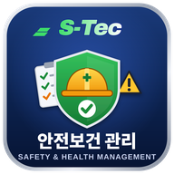

# S-Tec Safety & Health Management System (에스텍 안전보건 관리 시스템)



**에스텍 그룹 안전보건 관리 시스템 (중대재해처벌법 대응)** · v1.0.2 · 통합관리 시스템 메인 화면 「근태관리」 다음 카드 (`stsh`)

> 당사(사업주)와 고객사(도급인)가 각자 지는 안전보건 확보 의무를 **「했다」는 기록**으로 남깁니다.
> 사고가 난 뒤에는 기록이 없으면 이행한 것으로 인정받기 어렵습니다. 위험성평가 · TBM · 안전점검 · 아차사고 · 교육 · 보호구 · 도급인 협의를 사업장별로 한곳에 쌓습니다.

## 내려받기

| 구분 | 주소 |
|---|---|
| 웹 버전 | https://sadness500-boop.github.io/S-Tec-Safety-and-Health-Management-System/ |
| 파일 하나로 여는 배포본 | `releases/S-Tec-Safety-and-Health-Management-System_v1.0.2.html` |
| 안드로이드 앱 (최신) | https://github.com/sadness500-boop/S-Tec-Safety-and-Health-Management-System/releases/download/app-latest/stsh-latest.apk |

- **APK는 GitHub Actions가 만듭니다.** `index.html`·`version.json`을 올리면 Actions 「Android APK」가 약 5분 뒤 `releases/`와 릴리스에 APK를 올립니다.
- **웹 주소를 열려면** 저장소 Settings › Pages › Branch를 `main` / `/(root)`로 한 번 켜야 합니다.

## 기능

| 메뉴 | 내용 | 주기 |
|---|---|---|
| 📋 위험성평가 | 사업장·업종·작업별 유해위험요인 · 가능성(1~5)×중대성(1~4) · 감소대책 · 개선 후 위험성 · 담당·완료일 · 근로자 참여 | 최초 · 정기(매년) · 수시 · 상시 |
| 🗣 TBM | 작업 전 모바일 작성 · 오늘의 위험요인(위험성평가에서 자동 제안) · 계절 위험 · 안전수칙 · 건강상태 · 참석자 **터치 서명** · 현장 사진 | 매일(작업 전) |
| ✅ 안전점검 | 보안(순찰동선·야간 조도·흡연구역·화재수신기 사각지대) · 미화(약품·사다리·습식 바닥) · 주차(차량 충돌) · 시설(전기·고소·밀폐) · 안내 · 조리 + 공통 | 주 · 월 |
| ⚠ 아차사고·의견 | 사진 1장 + 한 줄 보고 · 등급 A/B/C · **원본 수정 불가(보완은 이력)** · SHA-256 해시 · 수시 위험성평가 자동 열기 · 법정 보고 안내 · 종사자 의견 청취 | 수시 |
| 🎓 교육·보호구 | 근무자 명부 · 채용 시/정기/특별/비상훈련 이수 · 반기 정기교육 시간 자동 집계 · 미이수자 알림 · 보호구 지급일·교체일·수령 서명 | 수시 |
| 🤝 도급인 협의 | 안전보건 협의체(매월) · 합동 안전보건점검(분기) · 순회점검 · 고객사·당사 서명 · 후속 조치 추적 | 월 · 분기 |
| 📊 안전보건 현황 | 사업장별 이행률 · 안전보건 이행지수(SHI) · 미조치 · 기한 임박 · **중대재해처벌법 시행령 제4조(9개)·제5조 반기 이행 현황** | 상시 |

**SHI(Safety & Health Index)** = TBM 실시율 25 + 안전점검 이행률 20 + 위험성평가 관리 20 + 조치 완료율 15 + 교육 이수율 15 + 보호구 관리 5 · 95↑ S · 90↑ A · 80↑ B · 70↑ C · 70 미만 D

## 출력물 (Word는 에스텍 표준 머리글 「The Best Choice」 · 바닥글 쪽번호 · 제작자 서명)

| 출력 | 형식 |
|---|---|
| 월간 안전보건 활동보고서 | Word · PDF · PPT |
| 고객사(도급인) 제출용 안전보건 이행 현황 — 시행령 4·5조 대응 · 월별 실적 · 재발방지 · 협의체/합동점검 · 확인 서명란(근무자 이름 가림 선택) | Word · PDF · PPT |
| 위험성평가표(근로자 공유 확인란) | Word · PDF · 엑셀 |
| TBM 일지(참석자 서명 · 사진) | Word · PDF |
| 안전점검표 · 도급인 협의록/합동점검표 | PDF · Word |
| 사고 경위서·조치결과서(보완 이력 · 수시 위험성평가 · 원본 해시) | Word · PDF |
| 사업주 안전보건 확보의무 이행 증빙(사건 전 90일 기록 — 법률 대응용) | Word · JSON |
| 전사 안전보건 현황(사업장별 이행률 · 조치 대장 · 사고 대장 · 교육 이력 · 보호구 대장) | 엑셀 |

## 통합 로그인 · Supabase · 연동

- `auth-config.json`이 통합관리 시스템과 **같은 Supabase 서버**를 가리킵니다 — 하나의 아이디, 프로그램별 관리범위 권한.
- **처음 한 번:** Supabase → SQL Editor → [`server/supabase_stsh.sql`](server/supabase_stsh.sql) 실행 (다시 실행해도 안전)
  - 프로그램 등록부에 `stsh`를 근태관리 다음(sort 25)으로 등록 → 메인 카드 · 「🔐 프로그램별 권한」
  - `sh_records` (+ `sh_put`·`sh_list`·`sh_delete`) — 사고·아차사고는 첫 원본(`first_data`) 보존 · 삭제 불가
  - `sh_kpi` (+ `sh_kpi_put`·`sh_kpi_list`) — 성과관리 · 고객사 포털[14]이 읽는 월간 안전 지표
  - `sh_links` (+ `sh_link_push`·`sh_link_list`·`sh_link_done`) — 법률 대응 시스템으로 증빙 묶음(해시) · 검토 완료 요약 회신
  - `sh_adhoc_ra` — 사건·사고 즉시 보고[16]가 수시 위험성평가를 여는 함수
- 연결 지점: 근태관리 `ams_roster(p_site, p_date)` → TBM 참석 대상 · 업무표준화 `stos_tasks(p_job)` → 위험요인 초안 (없으면 내장 표준을 씀)
- SQL 실행 전에도 이 기기 저장 + 계정 동기화(`user_data`의 `stec_sh_data`·`stec_sh_ui`)로 동작합니다.

## 개인정보 · 공개 저장소 원칙

- 이 저장소에는 **실제 고객사 사고 · 근무자 자료를 넣지 않습니다.** 「🧪 예시 자료」는 가상 사업장(예시 가람공장 · 예시 나래빌딩)뿐이며 공유 서버에 올라가지 않습니다.
- GPS·상시 위치 수집 없음 · 사진은 560px로 줄여 저장 · 얼굴·차량번호 촬영 금지 안내 · 고객사 제출본 이름 가림 선택.
- 사용자 매뉴얼은 누구나(📘) · 제작자 관리매뉴얼은 제작자만(서버 비공개 보관함 `owner-docs/stsh/admin-guide.json`).
- 법정 주기·교육시간은 기본값(산업안전보건법 시행규칙 별표 4, 제79·80·82조 등)입니다. 법령 개정 시 `source/kb.js`에서 바꿉니다.

## 파일 구성

```
index.html            프로그램 전체 (한 파일, 라이브러리 내장)
source/               원본: kb.js(위험요인·점검·보호구·교육·법령) · app.js(기록·이행률·SHI·서버) · views*.js(화면) · out*.js(Word·PDF·PPT·엑셀) · guide.js(매뉴얼) · demo.js(가상 예시) · build.py
media/video · thumb   메인 화면 안전교육 영상 3편 · media/manual 매뉴얼 화면 사진
server/               Supabase SQL
icons/ · assets/      앱 아이콘
.github/workflows/    안드로이드 앱 자동 빌드
```
빌드: `python3 source/build.py`

Designed & Developed by Rat Rae Choi
